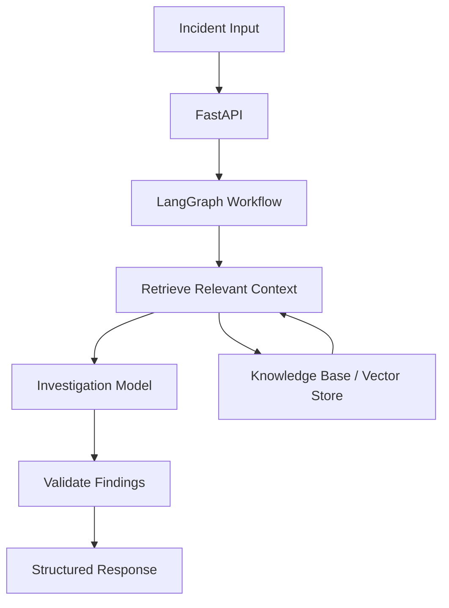

# <a href="ai-powered-production-incident-inve.vercel.app"> AI-Powered-Production-Incident-Investigation-Agent </href>

An AI-powered incident investigation system that combines local LLMs, retrieval-augmented generation (RAG), and graph-based orchestration to analyse production incidents, correlate available evidence, and generate structured findings with traceable source references.

The goal is to reduce manual investigation effort while making AI-generated conclusions more explainable, testable, and reliable.

## Key Features

- **Graph-based orchestration:** Organises investigation into modular steps using LangGraph.
- **Retrieval-Augmented Generation (RAG):** Retrieves relevant documentation and knowledge-base content to ground investigations in available evidence.
- **Local LLM inference:** Uses Ollama to run models locally, reducing dependence on paid inference APIs.
- **Structured investigation results:** Returns machine-readable findings suitable for downstream applications.
- **Evidence traceability:** Associates findings with retrieved source documents to support verification.
- **API-based integration:** Exposes investigation functionality through a FastAPI backend.
- **Validation and testing:** Tests workflow behaviour, response structure, and failure scenarios.

> Implementation status: This is a local-first prototype under active development. Features described above should be marked complete only after they have been implemented and tested in the current codebase.

## Tech Stack

| Component | Technology |
|---|---|
| Language and API | Python, FastAPI |
| Workflow orchestration | LangGraph |
| LLM inference | Ollama, Qwen 2.5 7B |
| Retrieval | RAG, local vector store |
| Supporting technologies | Java, Spring Boot, PostgreSQL, Redis, Docker |

Technologies listed above may represent planned or supporting components; their inclusion does not imply that every component is currently integrated.

## Architecture

### Investigation Flow

1. **Receive the incident:** Accept incident identifiers and the available incident data.
2. **Retrieve relevant context:** Search the knowledge base for documentation relevant to the incident.
3. **Investigate:** Pass the incident evidence and retrieved context to the LLM.
4. **Validate:** Check the resulting findings against the expected response schema and available evidence.
5. **Return results:** Produce structured findings and source references through the API.

The workflow is designed to keep retrieval, investigation, and validation as distinct responsibilities so each stage can be tested and improved independently.

## Architecture Decisions

### 1. Why use LangGraph?

Incident investigation is a multi-step process rather than a single prompt-response interaction. Different stages need different inputs, intermediate state, validation, and potentially conditional execution.

LangGraph provides explicit workflow nodes and state transitions, making the investigation process easier to inspect, test, and extend.

**Alternatives considered**

- **A single LLM call:** Simpler and cheaper to implement, but offers limited control over intermediate steps and evidence validation.
- **A manually orchestrated Python pipeline:** Provides greater control with less framework overhead, but requires more custom logic for state management and conditional workflows.
- **A general-purpose agent framework:** Could offer broader autonomous tool use, but may introduce unnecessary complexity for a workflow with defined stages.

**Trade-off:** Graph-based orchestration adds implementation and debugging overhead. It is justified when explicit control, modularity, and traceability are more valuable than minimal complexity.

### 2. Why use RAG?

An LLM's general training knowledge may not contain the internal documentation, service dependencies, runbooks, or historical incident information needed to investigate a specific failure.

RAG retrieves relevant information at investigation time and provides it as context to the model.

This allows the knowledge base to evolve without retraining the model.

**Alternatives considered**

- **Prompt-only investigation:** Easy to build, but limited by the context explicitly supplied to the model.
- **Fine-tuning:** Can adapt model behaviour, but updating factual operational knowledge through repeated training is less convenient.
- **Full-context retrieval from all documents:** Avoids some retrieval misses but can increase latency, token usage, and irrelevant context.

**Trade-off:** RAG introduces retrieval errors, indexing overhead, and the possibility of missing relevant documents. Retrieval quality must therefore be evaluated independently from generation quality.

### 3. Why run the LLM locally?

Local inference supports experimentation without requiring paid hosted inference APIs. It also provides greater control over where incident data is processed.

Ollama simplifies local model execution and makes it practical to develop and test the investigation workflow on a personal machine.

**Alternatives considered**

- **Hosted LLM APIs:** Often offer stronger models and simpler scaling, but introduce provider costs, network dependencies, and data-governance considerations.
- **Self-hosted inference on dedicated GPU infrastructure:** Provides more control over deployment and capacity, but requires infrastructure management and operational expertise.

**Trade-off:** Local inference is constrained by available CPU, GPU memory, model size, and concurrency. A local development setup is not automatically suitable for production traffic.

### 4. Why separate the API from the investigation workflow?

FastAPI provides an interface between clients and the investigation logic. Separating request handling from graph execution makes the workflow easier to test and allows its implementation to evolve without requiring every client to change.

The API should also enforce input validation, response contracts, error handling, and appropriate request limits.

**Alternatives considered**

- A monolithic implementation combining request handling and investigation logic.
- A separate investigation service accessed through an API or message queue.

**Trade-off:** Separation improves modularity, but additional services introduce deployment, networking, and monitoring overhead. A single-process prototype is sufficient until there is a demonstrated need to separate components.

## System Evaluation

The system should be evaluated at three levels: retrieval, investigation quality, and operational performance.

| Area | Evaluation approach | Useful metrics |
|---|---|---|
| Retrieval quality | Compare retrieved documents against manually identified relevant sources | Recall@k, Precision@k, MRR |
| Finding accuracy | Compare investigation findings against reviewed incident evidence | Precision, recall, unsupported-claim rate |
| Source traceability | Verify that cited sources exist and support the associated findings | Citation validity, evidence coverage |
| Output reliability | Test responses against the required schema | Schema-valid response rate |
| Performance | Measure complete investigations across representative inputs | p50/p95 latency, throughput |
| Resource usage | Observe inference and retrieval under load | CPU/GPU memory, tokens, queue depth |
| Reliability | Exercise timeouts, empty retrievals, malformed responses, and dependency failures | Failure rate, recovery rate |

### Evaluation methodology

1. Build a representative set of incidents with expected findings and relevant source documents.
2. Establish a baseline without retrieved context.
3. Evaluate the same incidents with RAG enabled.
4. Compare finding accuracy, unsupported claims, retrieval quality, and response latency.
5. Repeat tests across different incident types, including incidents with incomplete evidence.
6. Record regressions and use repeatable tests to validate changes.

Evaluation should distinguish between a plausible-sounding answer and a correct, evidence-supported investigation. Metrics should be reported from actual test runs rather than estimated.

## Scalability: What Happens if Traffic Increases 100x?

A local prototype is not designed to handle a 100x increase in concurrent traffic without architectural changes. Scaling requires identifying the bottleneck rather than simply adding more API workers.

### Potential bottlenecks

- LLM inference capacity and GPU memory.
- Concurrent requests competing for the same model.
- Retrieval latency and vector-store throughput.
- Long-running investigations occupying API workers.
- Memory growth and unbounded queues.

### Proposed scaling strategy

1. **Decouple request handling from execution:** Introduce a durable task queue for long-running investigations and return a job identifier.
2. **Scale API workers horizontally:** Run multiple stateless API instances behind a load balancer.
3. **Scale inference separately:** Use dedicated inference workers, request batching where supported, and bounded concurrency.
4. **Optimise retrieval:** Tune retrieval parameters, index size, filtering, and caching based on measured workloads.
5. **Apply backpressure:** Enforce queue limits, timeouts, rate limits, and overload responses rather than accepting unlimited work.
6. **Introduce observability:** Track queue depth, inference latency, retrieval latency, failures, and resource utilisation.
7. **Load-test incrementally:** Increase request rates and concurrency until the first resource or latency constraint becomes visible.

A 100x increase in traffic does not necessarily require 100x the hardware. Actual capacity depends on request complexity, model throughput, concurrency, caching, and latency targets. These need to be measured before estimating infrastructure requirements.

## Debugging Production Failures

The investigation system should make it possible to identify which stage failed without exposing sensitive incident data unnecessarily.

### Debugging workflow

1. **Identify the failing request:** Use a correlation ID or investigation ID to trace the request across services.
2. **Inspect structured logs:** Record workflow stage, duration, retry count, error category, and dependency status.
3. **Inspect graph state:** Determine whether the failure occurred during retrieval, model inference, validation, or response serialization.
4. **Check retrieval:** Verify query construction, retrieved document identifiers, relevance scores where available, and empty-result behaviour.
5. **Check model inference:** Inspect timeouts, resource exhaustion, malformed output, and model availability.
6. **Validate the response:** Check schema violations and whether cited sources actually exist in the retrieved evidence.
7. **Reproduce the failure:** Replay a sanitised incident fixture through the same workflow and model configuration.
8. **Add a regression test:** Ensure that the failure does not silently return in later changes.

### Resilience principles

- Use bounded retries for transient failures, with backoff and jitter where appropriate.
- Avoid blindly retrying deterministic errors or every failed model response.
- Apply timeouts to external dependencies and model calls.
- Return explicit errors or partial results only when their semantics are well defined.
- Preserve enough diagnostic information to investigate failures without logging secrets or unrestricted production data.

## Limitations

- Investigation quality depends on the quality and completeness of the available incident evidence.
- Retrieval can miss relevant documentation or return irrelevant passages.
- LLM-generated findings may be incorrect even when the response is structurally valid.
- Local inference throughput is limited by the development machine's resources.
- Source references improve traceability but do not independently guarantee that a conclusion is correct.

## Future Improvements

- Add a benchmark dataset for incident investigation quality.
- Improve retrieval using metadata filtering, chunking experiments, and reranking.
- Enforce evidence-backed findings and validate source references.
- Add graph-level tracing, structured logs, and latency metrics.
- Introduce asynchronous execution and durable job tracking for long-running investigations.
- Add concurrency and failure-injection tests.
- Explore incident-history retrieval and integrations with observability platforms.
- Evaluate a dedicated inference service for larger workloads.

## Running Locally

The project is being developed as a local-first application using Python, FastAPI, LangGraph, and Ollama.

To run the application, install the project dependencies, ensure the configured local model is available, set the required environment variables, and start the API using the repository's configured entry point.

Refer to the project source and dependency files for the current setup commands and required configuration.

## Project Goal

Build an incident investigation assistant that is not only capable of generating useful explanations, but can also retrieve relevant knowledge, expose its evidence, validate its output, and be evaluated systematically for reliability and performance.

